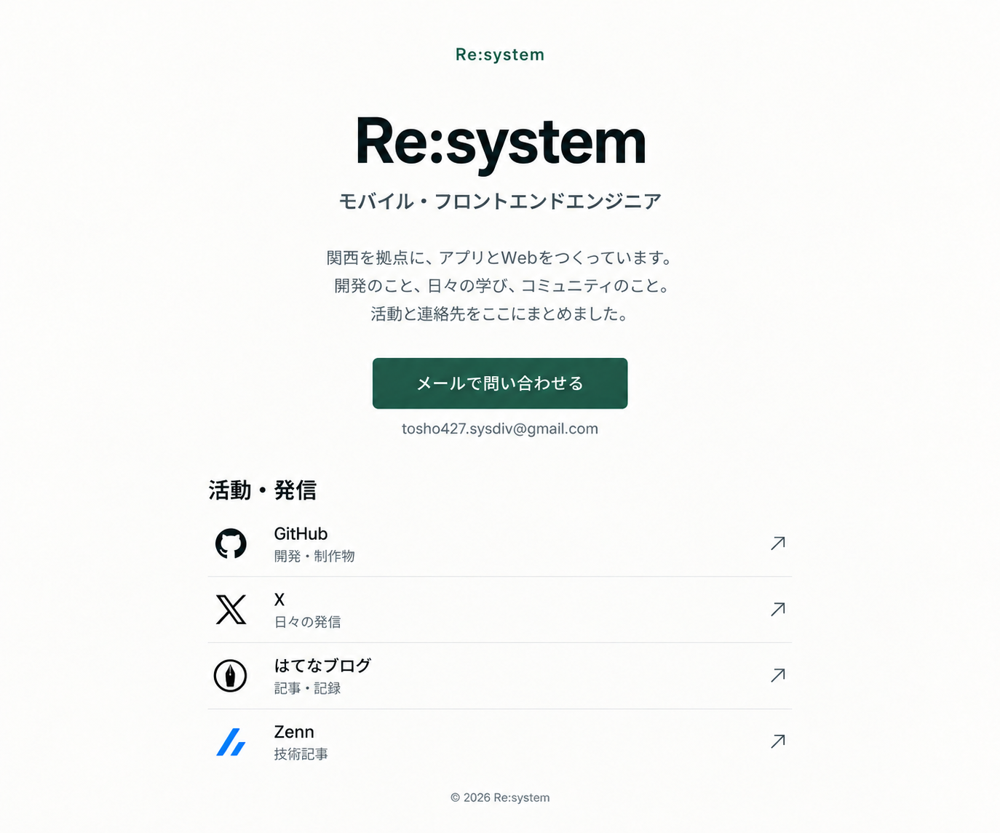

# Re:system LP 実装用設計メモ

元資料：Obsidian `PrivateKnowldgeNote/004_dev-docs/designs/self-introduction-lp-design.md`（2026-10-24）。
本文の掲載候補は同設計書第5節、挙動は第6節を基準とします。
このメモは実装に必要な情報をまとめたもので、元の設計書を変更するものではありません。

## 仕様

- 日本語、中央寄せ1カラム、最大幅720px。スマートフォンの左右余白20px。
- 背景 `#FAFAF8`、文字 `#172422`、補助文字 `#5D6A70`、深緑 `#245C49`、罫線 `#DDE2DF`。
- 屋号は上部・h1・フッターで `Re:system` に統一。
- 標準サンセリフを使用。メイン屋号はPC72px、スマートフォン40〜48px。
- 問い合わせボタンは幅320px以内、高さ60px以上、角丸8px。連絡先文字列を直下に表示。
- 活動先はGitHub → X → はてなブログ → Zenn。行全体をリンクにし、80px以上の高さと罫線で整理。
- 通常のメールリンク、外部リンクは同じタブ。送信完了を装う表示を設けない。
- 写真・フォーム・スキル一覧・実績一覧・固定ナビ・出現待ちアニメーションは表示しない。
- 1つのh1、main、見出し順、キーボードフォーカス、装飾アイコンの空altを使用。
- 公開用原稿と連絡先は `src/data/profile.ts` で管理。初期掲載候補は公開前に本人が確認する。

## 参照画像との調整

採用画像を配色、中央寄せ、余白、文字の強弱、行の構成の基準としています。
実寸は設計書の720px幅・72px見出しを優先し、モバイルでは本文の自然な折り返しを許容しています。
画像は設計資料としてのみ保存し、LP本体には読み込みません。
